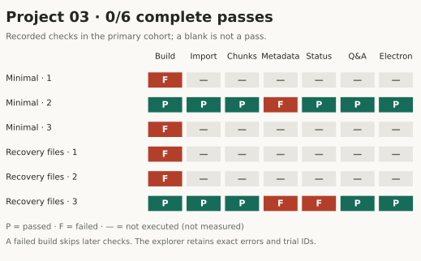
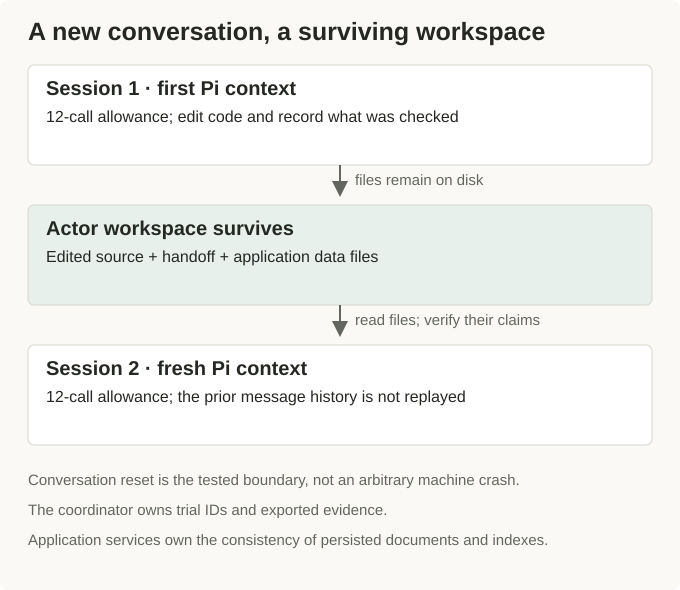
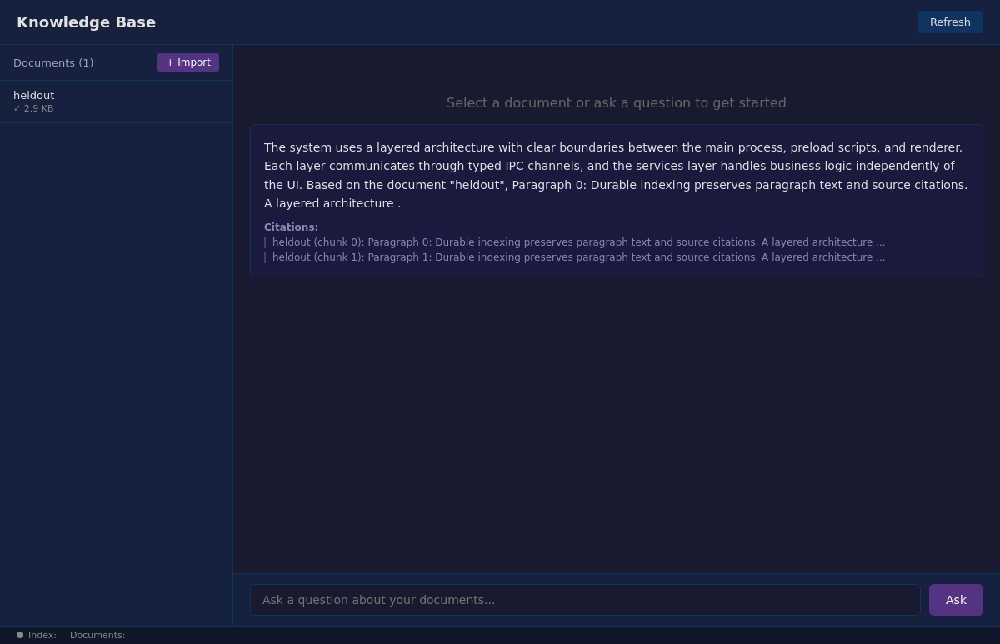

<script setup>
import forgeImage0 from './assets/figures/project-03-checks.svg?url'
import forgeImage1 from './assets/diagrams/session-boundary.svg?url'
import forgeImage2 from './assets/captures/9d859517-72db-4b1a-a683-cd81b9f7ca14-grader-visible-answer.png?url'
</script>

# What survives when the next session starts

The next coding session can open the files the previous session changed. It cannot infer which of those changes were tested, which were guesses, or which error the previous session was about to investigate. A handoff has to carry that distinction explicitly.

Project 03 asks Pi to finish indexing and grounded Q&A across two fresh conversations. The task includes document metadata, nonempty paragraph chunks, single-document index status, and citations from retrieved excerpts. We compared minimal instructions with a recovery treatment that asks the agent to persist its progress and read it on restart.

Both treatments finished at 0/3 passes. Four submissions failed compilation. The two that compiled failed the metadata check, and one of those also left single-document indexing status incorrect. The recovery treatment did not produce a passing continuation in these attempts.


<div class="forge-figure" tabindex="0" role="region" aria-label="Project 03 matrix of individual attempts and the checks they passed, failed, or did not execute.">

<a :href="forgeImage0" target="_blank" rel="noopener"></a>

</div>

Four builds failed. The two compiled submissions failed metadata; one also failed index status. The gray cells were never measured. [Read every grade and its evidence](./evidence?scope=primary&project=project-03#inspect-every-attempt). Open the image for full size; wide figures scroll on small screens.

## There are several different things to remember

We often describe this problem as agent memory, which makes it sound as if a larger conversation history would solve it. The course has several kinds of state, owned by different processes.

| State | Owner and persistence | What a new session must do |
| --- | --- | --- |
| Prior conversation | Pi session; not replayed into the next course conversation | Recover task context from the supplied task and files |
| Edited source and handoff | Actor sandbox filesystem | Read the patch and verify its claims |
| Imported documents and index | Application persistence service | Reconstruct services and check stored data |
| Trial identity and exported evidence | Coordinator and result directory | Match the attempt to its patch, grade, and traces |

A handoff file belongs in the second row. It cannot prove the third row is consistent. A saved transcript belongs in the first row. It cannot prove a sandbox survived or a remote command completed.

Our two-session experiment resets the model conversation while retaining the actor workspace. It is a controlled session boundary, not an arbitrary machine crash. Separate sandbox qualification exercises cover interruption and cleanup. Keeping those tests distinct prevents a successful handoff demonstration from becoming a claim of recovery from every kind of failure.


<div class="forge-figure" tabindex="0" role="region" aria-label="Session one writes files into a surviving workspace; session two starts a fresh Pi context and reads those files.">

<a :href="forgeImage1" target="_blank" rel="noopener"></a>

</div>

The conversation resets while the actor workspace survives. Application consistency and coordinator recovery have separate owners. Open the image for full size; wide figures scroll on small screens.

## Give the next session something it can disprove

Anthropic's [long-running harness account](https://www.anthropic.com/research/effective-harnesses-for-long-running-agents) describes an initializer, incremental coding sessions, and persistent progress artifacts. It emphasizes leaving enough information for a fresh context to determine what remains unfinished. Our course tests a smaller version of that problem with two conversations and a fixed allowance.

The practical requirement is that the next session can check the handoff. “Indexing is done” is difficult to audit. A note that records the tested fixture, the observed chunk count, and the still-failing status assertion gives the next session concrete work.

Here is an illustrative handoff format, not a quotation from a successful trial:

```text
Changed: the single-document indexing path writes chunk files.
Observed: the status check still reports currentIndexed = 0.
Unverified explanation: the document-to-chunk registry may not be updated.
Next check: import a new document, index only that ID, then read status.
Do not mark complete until the stored chunks and status agree.
```

The proposed explanation could be wrong. That is acceptable because the note labels it and supplies a way to check it. An unqualified “fixed” would force the next agent to discover the discrepancy again.

## The data file and the status can disagree

The starter's single-document indexing path writes a chunk file and returns the current status. The status calculation reads a separate document-to-chunk registry. Writing one without updating the other leaves two views of the same work inconsistent.

The protected check creates a fresh store, imports a document, indexes only that document, and asks how many documents are indexed. One compiled submission returned zero where the check required one. This is a precise failure: content can have been processed without the application's status representing that work.

The metadata failures expose another incomplete path. The task requires `wordCount`, `lineCount`, and `paragraphCount` on the document. The checker reads the saved document metadata and requires positive values. Both compiled submissions failed at `wordCount`; that does not tell us whether the later fields would have passed, because the assertion stops at the first failure.

The later metadata fields remain unobserved in that check. A summary that reports all of them as failed would invent results for assertions the grader never reached.


<div class="forge-figure" tabindex="0" role="region" aria-label="Project 03 failed submission showing a rendered answer and citations despite its metadata failure.">

<a :href="forgeImage2" target="_blank" rel="noopener"></a>

</div>

Minimal repeat 2 rendered an answer and still failed the metadata assertion. A reassuring screen cannot erase that failing grade. [Inspect the patch and all checks](./evidence?scope=primary&project=project-03&trial=9d859517-72db-4b1a-a683-cd81b9f7ca14#inspect-every-attempt). Open the image for full size; wide figures scroll on small screens.

## A handoff has to fit the remaining work allowance

Each conversation has 12 model calls. Spending the second conversation reconstructing the whole repository leaves fewer calls for the incomplete feature. We can inspect whether that happened in a particular trace, but the aggregate pass count cannot tell us how much time or effort a handoff saved.

The four compilation failures also limit what the experiment says about recovery. Those submissions never reached the downstream service and UI assertions. We cannot infer that their persistence, retrieval, or rendered citations would have failed independently. Compilation prevented us from observing those behaviors.

For a follow-up, I would separate handoff quality from feature difficulty. Start a new session from a fixed, partly completed patch and compare a factual handoff with no handoff. Keep the patch identical so that one condition does not inherit easier work. That would isolate the information passed across the session boundary more closely than this course's broader treatment.

## Read the continuation from both ends

Choose a saved attempt in the [Project 03 notebook](https://forge.coreweave.com/notebooks/Tm90ZWJvb2s6MTUzMTY%3D). Compare the end-of-session checkpoint with the first operations of the next conversation. Look for a claim in the handoff that the next session verifies, revises, or accepts without checking.

Then read the protected grade. If the handoff says indexing is finished but the stored status is wrong, preserve both records and carry that unresolved assertion into the next handoff. The [public results report](https://github.com/ash0ts/learn-harness-engineering/blob/codex/forge-publication/forge/results/README.md) keeps these unsuccessful attempts; the private notebook links to their fuller evidence.

The next article starts inside the running application. In [Project 04](./04-runtime-feedback.md), the index reported work completed while the chunks themselves contained no text.

[Browse the complete evidence companion](./evidence.md): original captures, all 129 attempts, source hashes, notebooks, dashboards, and private artifacts.
