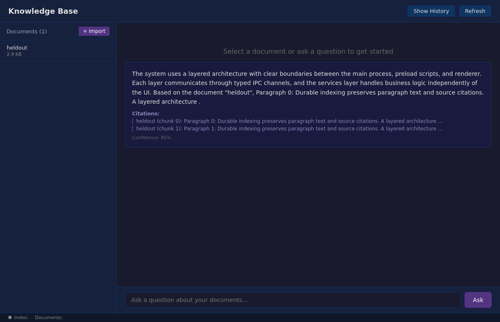
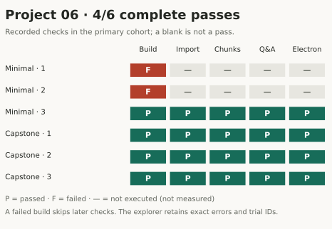

<script setup>
import forgeImage0 from './assets/captures/fd98af3b-1b52-448c-bc7b-b6cc47e785ea-grader-electron.png?url'
import forgeImage1 from './assets/figures/project-06-checks.svg?url'
</script>

# A reset button has to clear more than the screen

After a user resets a knowledge base, a new answer should not cite documents that were supposedly deleted. Clearing the document list is only part of that operation. The index can still hold text, the history can still hold answers, and a feedback store can still refer to both.

Project 06 asks Pi to harden the course app around those boundaries. It must expose feedback through typed IPC, clear the app's persisted state, verify real service behavior, and leave an evidence-backed handoff. We compared minimal instructions with the capstone guidance on the same unfinished application.

The qualified capstone treatment passed 3/3 attempts. Minimal instructions passed 1/3. The two unsuccessful minimal submissions failed compilation, so they never reached the reset and feedback checks. That is the observed difference; the result does not isolate which part of the capstone guidance caused it.

## We first had to say what the feedback API meant

Our initial task named `feedback.submit` and `feedback.list` without fixing the submission arguments. The checker assumed a particular calling convention. An implementation could make a reasonable choice and still disagree with the checker.

We corrected the task before running a new frozen comparison. Both treatments received the same object contract:

```ts
feedback.submit({
  question: string,
  answer: string,
  rating: 'positive' | 'negative',
  comment?: string,
})
```

This is a contract sketch, not a call with real values. It names the fields the service must preserve. The renderer sends the object through the preload bridge; the main/service layer handles storage. `feedback.list()` returns the saved entries.

The earlier grades remain archived and excluded from the qualified comparison. We did not reinterpret an ambiguous task after seeing which implementation the agent chose. The correction belongs to a new cohort with its own source revision.

Anthropic's [evaluation guide](https://www.anthropic.com/research/demystifying-evals-for-ai-agents) calls out this class of problem: a test should not assume a required script path or other contract that the task never supplied. Our feedback mismatch is a local example of why the task and grader need to be reviewed together.

## Test deletion through the operation that would expose leftover data

The protected UI check submits feedback for an answer already stored in history. It reads the feedback back and compares the question, answer, rating, and comment. It then calls `app.resetData()` and checks that documents, history, and feedback are empty.

The final check asks a question after the reset and requires zero citations. That exercises retrieval against the remaining state. If old chunks survive after the document list is cleared, retrieval can expose the inconsistency.

| State before reset | Observation after reset |
| --- | --- |
| Imported documents | Document listing is empty |
| Q&A history | History listing is empty |
| Submitted feedback | Feedback listing is empty |
| Retrievable index chunks | A new answer has no citations |

This is a bounded acceptance test. It does not prove every byte was securely erased, that deletion is atomic across a process crash, or that all future storage backends preserve the same behavior. It checks the operations the course exposes under the recorded fixture.

The feedback assertions also do not amount to a complete crash-recovery test for that store. They submit and read entries during the run. We can inspect a submission's persistence implementation, but we should not add a restart guarantee to the reported result merely because the task asked for persistence.


<div class="forge-figure" tabindex="0" role="region" aria-label="Capstone Electron window still displaying the previous document and answer after reset was invoked through the typed bridge.">

<a :href="forgeImage0" target="_blank" rel="noopener"></a>

</div>

This final frame from capstone repeat 1 still shows the previously rendered document and answer. The checker called reset through the bridge and verified empty stores plus zero new citations; it did not assert that the visible document list refreshed. A user-facing reset-flow test would need that additional observation. [Inspect this trial](./evidence?scope=primary&project=project-06&trial=fd98af3b-1b52-448c-bc7b-b6cc47e785ea#inspect-every-attempt). Open the image for full size; wide figures scroll on small screens.

## A benchmark command must execute the work it claims to measure

The capstone asks for a script that calls actual services. A script that prints a plausible success rate teaches the wrong lesson: it creates a number without performing the operation the number describes. The Forge grading path therefore instantiates the application's compiled services and runs the import, indexing, retrieval, and Q&A sequence itself.

This also establishes a boundary on the reported pass. The protected checker does not exhaustively audit every sentence in the agent's handoff or every possible implementation of its own benchmark script. It measures a defined set of compile, service, and Electron assertions. A reviewer still needs to inspect the delivered script before relying on it for another workload.

Our service Q&A uses deterministic course defaults. That makes the software path repeatable and allows an answer's citation excerpt to be checked against the imported content. It does not answer whether a live model gives a correct, complete explanation of a new document. The live Forge adapter has separate qualification evidence.

For a live deployment, the next evaluation would need documents and questions that test answer quality, in addition to these software assertions. Those judgments are outside this course's pass count.


<div class="forge-figure" tabindex="0" role="region" aria-label="Project 06 matrix of individual attempts and the checks they passed, failed, or did not execute.">

<a :href="forgeImage1" target="_blank" rel="noopener"></a>

</div>

The two failed minimal submissions stopped at compilation. The remaining four reached and passed the recorded service and Electron assertions. [Read every grade and its evidence](./evidence?scope=primary&project=project-06#inspect-every-attempt). Open the image for full size; wide figures scroll on small screens.

## What 3/3 versus 1/3 supports

The capstone treatment supplied the repository guide, architecture note, and instructions to leave completed work, failing checks, next steps, and paths in a handoff. The minimal treatment shared the same app, task contract, model settings, call limit, fixture, and protected checker.

We observed more passing submissions with the capstone package on this task. We did not run an ablation that removes the handoff request while retaining the architecture note, or vice versa. The difference cannot tell us which instruction was responsible. With three attempts per treatment, it is also too small to estimate a dependable success rate for future work.

The two compile failures give us a starting point for inspection. Read the failed build output beside the final diff. Then compare a passing minimal attempt with a passing capstone attempt. The minimal success is an important counterexample to a story in which the complete guide is strictly necessary.

For another experiment, I would first check whether the capstone guidance changes the frequency with which the agent compiles before exporting its patch. That is a behavior visible in the trace. Even if it differs, we would still need more tasks and controlled runs before claiming that behavior explains a general reliability improvement.

## Review the delivered state, then choose whether to rerun

The [Project 06 notebook](https://forge.coreweave.com/notebooks/Tm90ZWJvb2s6MTUzMTk%3D) loads the saved cohort and links to its private run evidence. The [public results report](https://github.com/ash0ts/learn-harness-engineering/blob/codex/forge-publication/forge/results/README.md) retains the earlier contract failure and the corrected comparison.

For a local review, trace one feedback object through submission and readback, then check what the reset implementation does to each store. Compare those operations with the protected assertions. A discrepancy is a concrete candidate for the next test, even when the current submission has a passing score.

The next two projects automate the decision to continue working. [Project 07](./07-bounded-loops.md) starts with the part that is easy to postpone: the conditions under which the coordinator should stop.

[Browse the complete evidence companion](./evidence.md): original captures, all 129 attempts, source hashes, notebooks, dashboards, and private artifacts.
