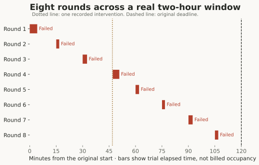
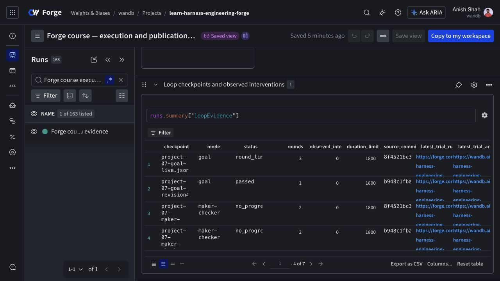

# Two hours of agent work, with a stop condition

We ran the timer exercise for its real two-hour window. It recorded eight coding rounds and ended at its deadline. All eight rounds retain `task_failed` outcomes under that historical protocol. Completing the timer demonstrated scheduled execution and stopping behavior; it did not demonstrate a completed repair.

In separate later runs, the goal loop passed after one round and maker/checker stopped after two identical empty patches. These outcomes came from different recorded source revisions. They are examples of the loop's behavior, not a controlled ranking of the three modes.

Project 07 uses the long-document indexing repair from Project 04. What changes is the coordinator around the coding trial: it stores progress, chooses whether another round should start, and records why it stopped.

## The coordinator owns the decision to continue

A round is a bounded coding attempt followed by protected grading. Its result includes an outcome and, when exported, a candidate patch. The coordinator records the trial ID, patch checksum, grade feedback, and current loop state before deciding what to do next.

The next round gets the candidate patch and the previous verification feedback. It starts a new agent conversation. Persisting these files gives the coordinator something concrete to pass forward without assuming the next model request remembers the earlier one.

The [Reflexion paper](https://arxiv.org/abs/2303.11366v4) studies using feedback and textual reflections to influence later trials without updating model weights. Our runner passes recorded verification feedback, but it does not reproduce Reflexion's full method or benchmark. The shared question is what information from an unsuccessful attempt should influence another attempt.

Before that information can help, the coordinator has to know whether the earlier attempt completed at all.

## An interrupted launch needs reconciliation

The loop writes a pending trial ID before starting work. If the coordinator is interrupted with that ID still pending, resume refuses to launch another trial automatically. It first needs evidence about the original launch.

A missing result file can mean the worker never started. It can also mean the worker ran and the coordinator lost the response. Starting a replacement immediately risks duplicate work and duplicate cost. The durable ID provides a handle for checking reservations, worker records, and completion evidence.

The real timer encountered a shared budget halt caused by a separate sandbox qualification. We recorded one observed intervention. The pending timer attempt had no reservation, settlement, or worker directory, and its campaign report contained no completed trials. That supported clearing a proven-unlaunched ID and resuming against the original deadline. We did not discard a trial result or restart the two-hour clock.

That intervention belongs in the execution record. Omitting it would turn a recovered exercise into a claim of uninterrupted autonomy.

## Each mode has a different reason to stop

| Mode | Normal continuation | Stop behavior |
| --- | --- | --- |
| Goal | Revise while the protected grade fails | Pass, unchanged patch, round limit, deadline, cancellation, or blocked work |
| Timer | Start bounded rounds on the recorded schedule | Deadline, cancellation, or blocked work; the round allowance also limits launches |
| Maker/checker | Use separate maker, review, and revision conversations inside each round | The goal-loop stop conditions, with the role schedule applied to each attempt |

Infrastructure failure, missing telemetry, or budget exhaustion blocks continuation. A normal task failure can lead to another bounded attempt. Those decisions use different evidence and should remain different statuses.

The unchanged-patch check compares consecutive exported checksums. In the later maker/checker run, both patches were empty and had the same checksum, so the loop stopped at `no_progress` after two rounds. That prevents repeated launches that have not changed the delivered code.

It is a narrow rule. Two different patches can both be useless, and two identical patches do not prove that the conversations contained no new understanding. The rule measures changed output, which is the object the next grading step can execute.

## Wall-clock time and compute are different measurements

The timer schedules work across the two-hour interval. It does not keep an idle sandbox allocated between rounds. The coordinator can wait while each completed trial's sandbox is terminated and its artifacts remain on disk.

This means a two-hour exercise is not two hours of continuous model execution or two hours of sandbox occupancy. We record worker durations and inference usage separately. The round limit and worker lifetimes bound each launch even when the overall timer window is longer.

Accelerated timer tests use a controllable clock to exercise scheduling and stop conditions quickly. They help check the code. They cannot serve as evidence that a real two-hour exercise ran. We kept the wall-clock run and accelerated checks as separate records.

The timer's historical grading protocol also predates the corrected visible-answer checks used in the primary comparison. Its failed grades remain historical observations. We do not promote them into current UI acceptance evidence, and we do not rescore them merely to make the timer's story cleaner.

The bars show each trial’s elapsed interval, including coordination and checking. They do not represent continuous inference or billed sandbox occupancy. [Inspect the timer checkpoint and all eight attempts](./evidence.md#loops-and-approval). Open the image for full size; wide figures scroll on small screens.

The operations view keeps the passing goal run, deadline completion, and no-progress stops as distinct outcomes. The recorded timer intervention remains part of the evidence. Open the image for full size; wide figures scroll on small screens.

## Read a checkpoint as an operational record

A loop checkpoint should tell another operator what can safely happen next. In this implementation it records the source revision, start and deadline, round limit, prior trial IDs, candidate patch path, feedback, pending work, and interventions.

Before resuming, resolve the paths to the candidate and prior trial evidence, then check whether a pending ID remains. Copying the JSON without its referenced patch and evidence directory does not give another coordinator enough information to continue the same work.

Open the [Project 07 notebook](https://forge.coreweave.com/notebooks/Tm90ZWJvb2s6MTUzMjA%3D) to inspect the saved checkpoints with private-project access. Before launching a rerun, use the [runner guide](./running.md#budget-and-recovery) to check the existing ledger and pending work. The [public report](https://github.com/ash0ts/learn-harness-engineering/blob/codex/forge-publication/forge/results/README.md) lists each loop's status and source.

Once a coordinator can continue, stop, and resume, it becomes possible to require different checks before a candidate moves forward. [Project 08](./08-state-machine.md) follows that candidate through rollback, parallel verification, and a separate human decision.

[Browse the complete evidence companion](./evidence.md): original captures, all 129 attempts, source hashes, notebooks, dashboards, and private artifacts.
