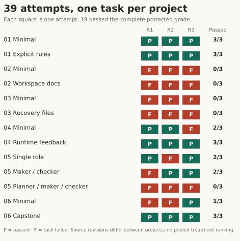
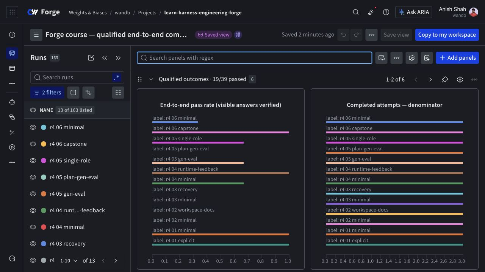
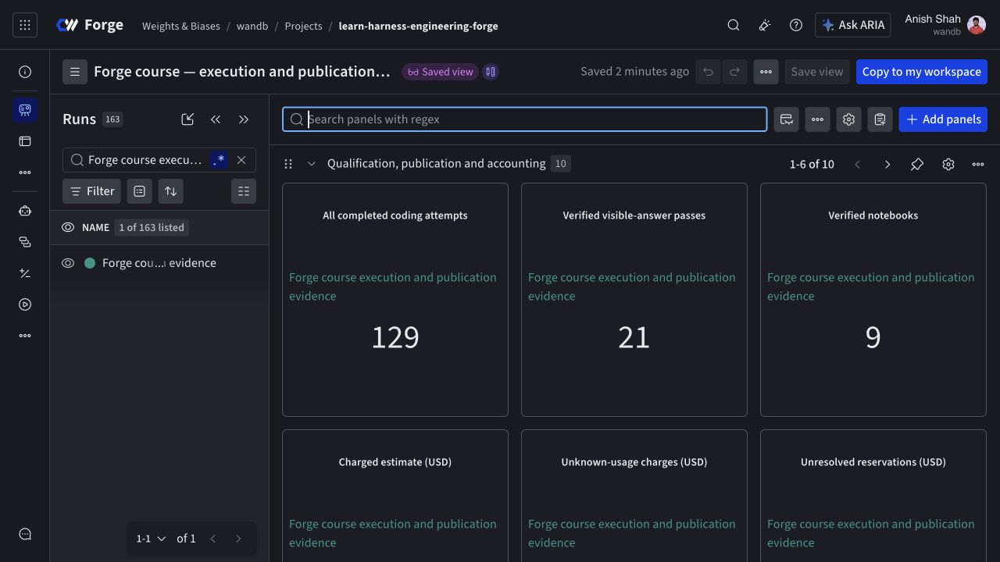
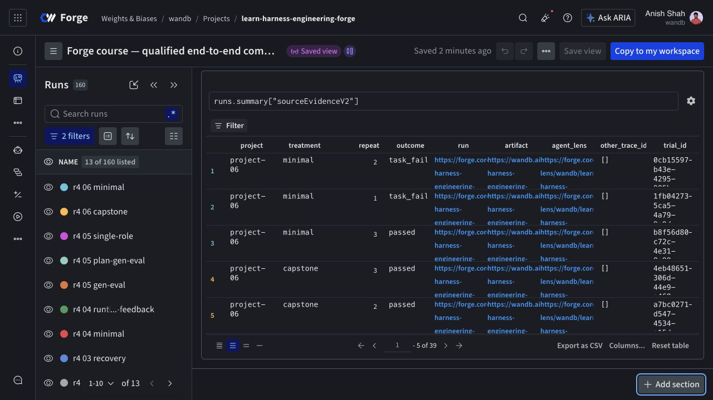
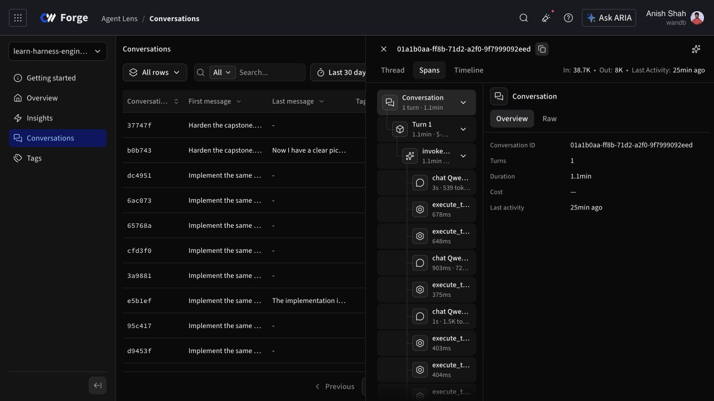
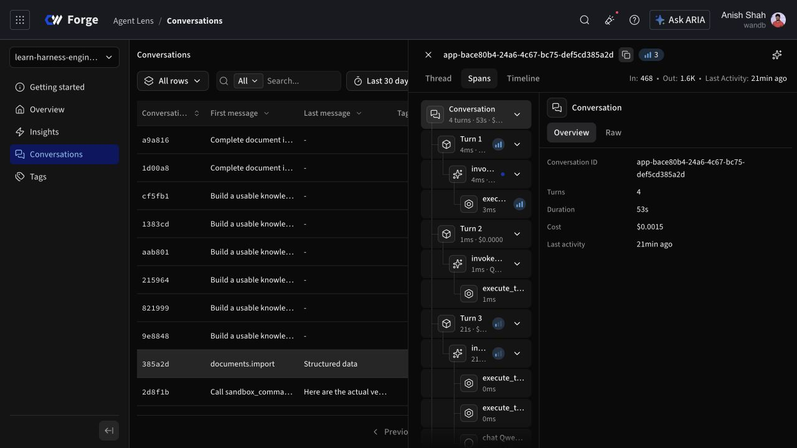
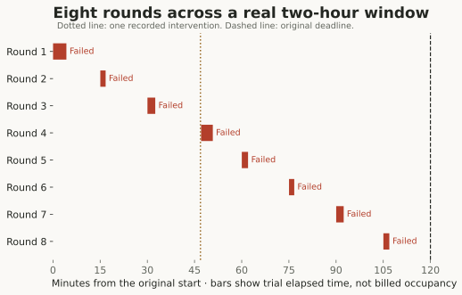
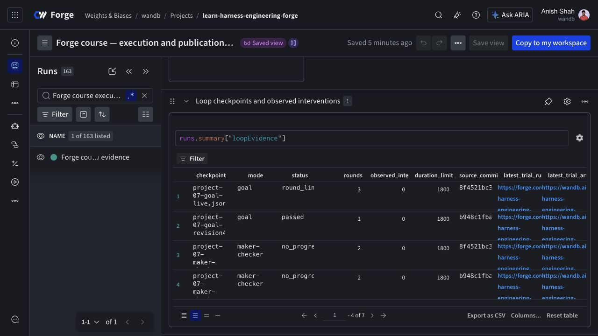
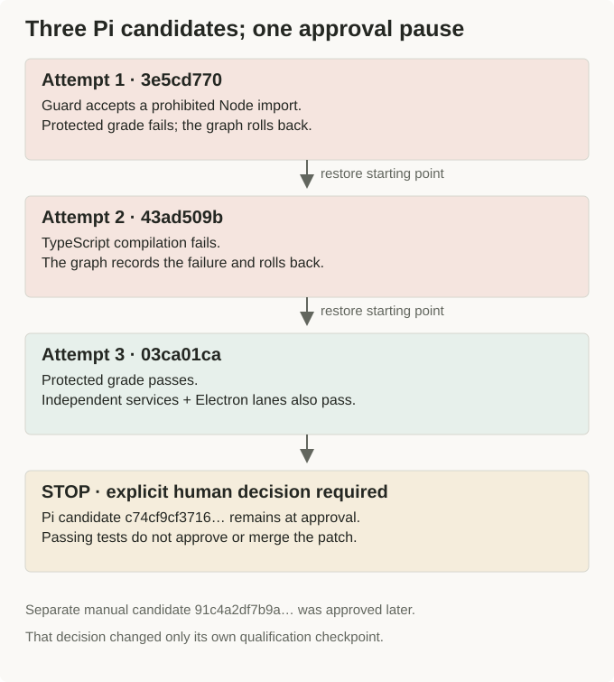
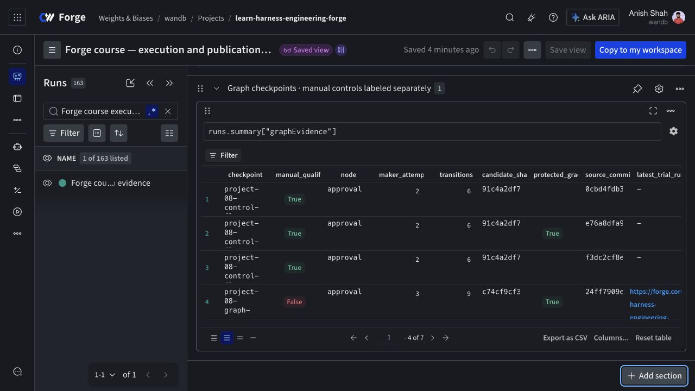

# See the runs, then inspect the evidence

The [Forge articles](./index.md) explain what happened. This companion lets you inspect it: original application captures, native Forge dashboards, Agent Lens conversations, individual check results, exported patch identities, and the files behind each attempt.

The primary comparison contains **39 attempts and 19 complete passes**. The broader archive contains **129 completed coding attempts** across historical comparisons, diagnostics, loops, and graphs. Those denominators stay separate throughout this page. Changing a filter does not rescore a trial.

All images below are original captures or explicitly labeled data figures and workflow diagrams. Nothing was redrawn to look like a successful application. The examples use sample course documents. Reading this page does not start inference, allocate a sandbox, or open a notebook runtime.

The separate [protocol 5 repair report](https://github.com/ash0ts/learn-harness-engineering/blob/codex/forge-publication/forge/results/protocol-v5/README.md) and [qualification dashboard](https://forge.coreweave.com/wandb/wandb/learn-harness-engineering-forge?nw=43tvw98k2nm) track the new implementation. The later [owner rehearsal and rollout receipt](https://github.com/ash0ts/learn-harness-engineering/blob/codex/forge-publication/forge/results/rollout-v5/README.md) records one live student attempt under a separate, bounded exception: execution and publication recovery completed, while its UI grade failed. All nine final notebook sources and rendered outputs are verified; native browser downloads remain unverified. The original unknown-usage reservation and the historical counts below are unchanged.

The subsequent [first-use setup repair](https://github.com/ash0ts/learn-harness-engineering/blob/codex/forge-publication/forge/results/first-use-repair/README.md) fixes the reported Prepare HTTP 404 when a notebook has no saved progress yet. The actual Prepare button, repeated setup, and remote checkpoint restore passed; this check launched no new inference or coding trial.

The [command cancellation repair](https://github.com/ash0ts/learn-harness-engineering/blob/codex/forge-publication/forge/results/cancellation-repair/README.md) fixes a later startup race in the small paid check. A fresh qualification and all three Project 01 acceptance controls passed, including Electron checks under Xvfb; Agent Lens usage was read back and reconciled. The failed learner attempt and its cost remain in history. These checks do not add to the comparison denominators below.

The [hands-on workshop release](https://github.com/ash0ts/learn-harness-engineering/blob/codex/forge-publication/forge/results/workshop-v1/README.md) adds editable application, harness and SDK exercises to Projects 01–05. Its separate [workshop dashboard](https://forge.coreweave.com/wandb/wandb/learn-harness-engineering-forge?nw=leid7r3frfp) retains 17 owner rehearsals: eight passes, six task failures and three infrastructure failures. A fresh private notebook copy completed the native edit/check/live-run path with matching source, screenshots, usage and traces. The [workshop guide](./workshop.md) covers the three-hour class and the laptop workflow. Assisted examples, browser upload/download limits, native picker limits and the absence of an independent student-account test are recorded in the release evidence. These rehearsals do not change the historical counts below.

The [eight-lab candidate](https://github.com/ash0ts/learn-harness-engineering/blob/codex/forge-publication/forge/results/workshop-v1.1/README.md) extends the practical workbench through Projects 06–08 and replaces the action selector with named exercises in all eight labs. Local checks and nine saved views pass. Live rehearsal encountered Sandbox access denial and was deferred; **the new candidate has not replaced the published Forge notebooks**. Its validation receipts and retained failure are separate from both the earlier workshop cohort and the research results.

## Start with the complete comparison

Each square is one attempt on its project's single task. **P** means the complete protected grade passed; **F** means the task failed. The source revision is fixed within a comparison and can differ between projects. Open a row below for the recorded check-level explanation. On a narrow screen, scroll the figure horizontally or open it at full size.

The public [CSV](/forge/evidence/trials.csv) and [JSON catalog](/forge/evidence/catalog.json) retain all 129 attempts, with primary membership explicit. The catalog includes frozen configuration, patch/checker/application hashes, trace links, and the original evidence-file inventory. Native historical grades are preserved even where later checker corrections limit their interpretation.

## Inspect every attempt

Select a project, cohort, or outcome, then open an attempt. The URL preserves filters and the selected trial, so a colleague can reopen the same evidence. **Not executed** means a check is absent from the recorded grade; it is neither a pass nor an independently observed failure.

<ForgeEvidenceExplorer />

The original patch, model/tool transcript, command logs, service outputs, checkpoints, and screenshots are in the [complete private evidence artifact](https://wandb.ai/wandb/learn-harness-engineering-forge/artifacts/course-evidence/forge-course-qualification-evidence:v4): **8,512 files, including 35 exact source archives**. The per-trial artifact link opens a smaller record for one attempt. Forge and W&B links require membership in `wandb/learn-harness-engineering-forge`; the figures, captures, and allowlisted index on this page are readable without that access.

Some attempts have no retained application screenshot. A compilation failure may prevent the UI stage from running; a UI timeout may occur before its capture point. The explorer says when an image is missing. It does not borrow an image from a later repair.

## Native Forge dashboards

The [visual evidence workspace](https://forge.coreweave.com/wandb/wandb/learn-harness-engineering-forge?nw=su19wan3xra) adds native image panels, all 129 attempt rows, and a table of 123 original captures with source paths and checksums. Its single publication run contains saved results and is excluded from coding-trial counts.

The comparison dashboard filters to 13 aggregate treatment runs, each derived from three primary attempts. An aggregate run is a view of recorded evidence, not another coding attempt. The operations dashboard tracks execution and publication across the broader archive.

**Comparison view, captured November 6, 2026.** The left run-list count includes derived records; the comparison denominator is 39 attempts. [Open the saved native dashboard](https://forge.coreweave.com/wandb/wandb/learn-harness-engineering-forge?nw=dfs83wdpatt).

**Operations view.** The 21 visible-answer passes are drawn from **46 qualified attempts**, including the relevant loop and graph work. They are distinct from the primary 19/39 comparison. Recorded estimates total $19.042267, including $6 conservatively charged for unknown usage; these are not invoices. [Open the operations dashboard](https://forge.coreweave.com/wandb/wandb/learn-harness-engineering-forge?nw=l9e45ofb461).

The source table joins the comparison back to individual attempts. The recorded audits verified **129 trial artifacts**, **223 Agent Lens conversations**, and **337 terminal cleanup records**. These are readback and cleanup claims, not additional successful task grades. The [delivery report](https://github.com/ash0ts/learn-harness-engineering/blob/258cf51fdc692f9be60952d8dd811de90588a0c4/forge/results/README.md) retains the exclusions and qualification failures.

## Separate coding and application conversations

The coding-agent conversation records Pi editing the repository. The application conversation records the knowledge-base services running against documents. Keeping their roots separate prevents a tool call made while editing the app from being confused with an operation performed by the app.

The selected coding conversation is [`01a1b0aa-ff8b-71d2-a2f0-9f7999092eed`](https://forge.coreweave.com/agent-lens/wandb/learn-harness-engineering-forge/conversations/01a1b0aa-ff8b-71d2-a2f0-9f7999092eed). This view illustrates the recorded hierarchy; inspect its original spans for arguments and outputs.

The app qualification is [`app-bace80b4-24a6-4c67-bc75-def5cd385a2d`](https://forge.coreweave.com/agent-lens/wandb/learn-harness-engineering-forge/conversations/app-bace80b4-24a6-4c67-bc75-def5cd385a2d). The trace audit reconciles usage at model-call spans, excluding parent rollups that would double-count tokens. These captures are instrumentation examples, not extra primary repeats. [Project 04](./04-runtime-feedback.md) explains the boundary.

## All nine notebook views

These are original screenshots of the published Marimo notebooks. Their saved tables retain historical cohorts and may show broader counts than the primary comparison. The Project 08 view predates the later manual qualification approval. Each source link opens the corresponding notebook in Forge; viewing a hosted notebook can allocate its analysis runtime, while coding or inference reruns require a separate explicit action.

<ForgeCaptureGallery kind="notebook-screenshot" />

The [publication manifest](https://github.com/ash0ts/learn-harness-engineering/blob/258cf51fdc692f9be60952d8dd811de90588a0c4/forge/publication-manifest.json) records stable notebook IDs, source commits, source checksums, committed `currentVersion` values, and rendered-output checksums. A screenshot alone cannot establish that the saved source matches; that claim comes from the publication readback.

## Loops and approval

The timeline uses the actual start and finish timestamps of the eight trials in `project-07-real-timer-qualified.json`. The dotted line marks the recorded intervention; the deadline did not restart. A bar is full trial elapsed time, including provisioning and grading, not billed sandbox occupancy. The timer reaching its deadline does not turn its eight historical failed grades into a successful repair.

Goal, timer, and maker/checker executions use different recorded revisions. Their outcomes are examples of stop behavior, not a controlled ranking of loop modes. The JSON catalog retains every round ID and patch checksum.

The explicit-contract graph's candidates are [attempt 1](./evidence?scope=all&project=project-08&trial=3e5cd770-94e5-49f9-b478-a2043dc9a682#inspect-every-attempt), [attempt 2](./evidence?scope=all&project=project-08&trial=43ad509b-7eb5-4d9e-97c7-ff33567693fd#inspect-every-attempt), and [attempt 3](./evidence?scope=all&project=project-08&trial=03ca01ca-eb64-45ae-9317-824ca4a26026#inspect-every-attempt). Nine durable transitions lead to `approval`. The passing Pi candidate starts with checksum `c74cf9cf3716…` and remains paused.

This screenshot precedes the later human decision. The user approved **only** original manual qualification candidate `91c4a2df7b9a…`; its checkpoint moved to `done`. The [decision receipt](https://github.com/ash0ts/learn-harness-engineering/blob/258cf51fdc692f9be60952d8dd811de90588a0c4/forge/results/qualification-approval.json) and [private approval artifact](https://wandb.ai/wandb/learn-harness-engineering-forge/artifacts/course-evidence/forge-qualification-human-approval:v0) preserve the exact checksum, actor, timestamp, and before/after states. This approval is excluded from coding-trial counts and adds no missing historical protected check.

Supplemental screenshots: checker diagnostics, independent graph lanes, and manual qualifications

These captures are separate from the 129 coding-attempt records. Some document failing diagnostics. The folder and source artifact identify the corresponding result; a visible answer is not a passing grade. None is silently substituted for a missing primary-trial image.

<ForgeCaptureGallery kind="supplemental-screenshot" />

## Download and verify

The [portable visual bundle](/forge/evidence/forge-visual-evidence.zip) contains the original exported captures, editable SVG diagrams, SVG/PNG data figures, the CSV, JSON catalog, file manifest, and reproduction instructions. It is an allowlisted companion to the complete private evidence artifact, not a public copy of raw conversations or credentials.

Use the [file manifest](/forge/evidence/manifest.json) to check SHA-256 values and source identities. Every copied capture retains the original bytes and records its artifact path. The figure generator reads the same frozen dataset as the explorer and CSV. [Source and reproduction notes](https://github.com/ash0ts/learn-harness-engineering/blob/codex/forge-notebooks/forge/ARTICLE-VISUALS.md) explain the inputs, renderer, and claim boundaries.

For the full protected archive, download `forge-course-qualification-evidence:v4` through W&B, then retrieve the separate human-approval artifact. The original report, notebooks, screenshots, and artifact `v4` remain snapshots from before that approval. The current operations view contains the addendum. [Return to the series](./index.md).
