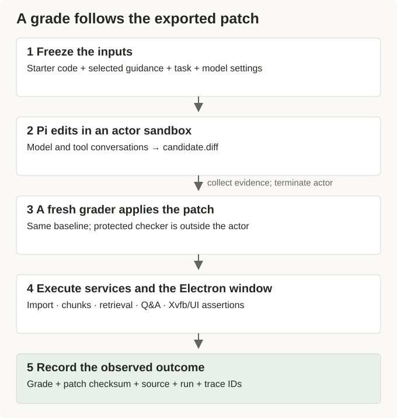
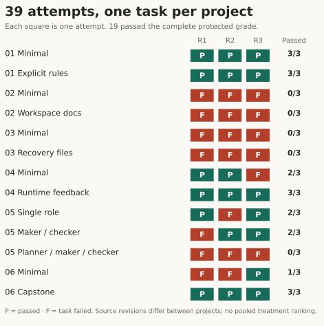
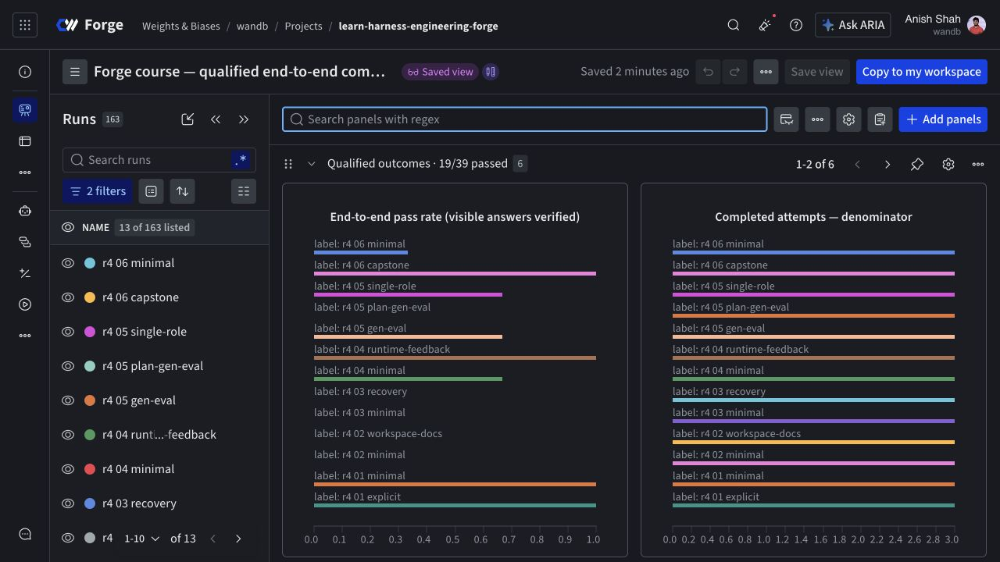

# A harness course with results you can inspect

We ran a coding agent through eight projects to see what happened when we changed the instructions, workspace documentation, feedback, and control flow around it. The agent built and repaired an Electron knowledge-base app. We kept its patches, opened the app, exercised its services, and recorded the failures alongside the successful runs.

The primary comparison finished with 19 passing attempts out of 39. That is enough to examine particular failures and design another experiment. It is nowhere near enough to announce the best way to build an agent.

This series follows the work in that order: what we asked the agent to do, what we allowed it to see, what it changed, and what survived independent checking. Each article connects to a saved notebook. You can read the results without launching a coding trial.

## One application gives the failures somewhere to happen

The application imports documents, splits their text into chunks, retrieves relevant excerpts, and answers questions with citations. An Electron main process owns the filesystem and services. A preload script exposes a typed interface to the React renderer, which draws the window and handles clicks. A document can therefore be saved correctly while the import button remains broken. An answer can exist in storage while the screen never displays it.

That separation gave us several kinds of failure to inspect. The course includes unfinished features, a seeded indexing defect, and opportunities for an agent to produce a convincing explanation without a working application. We preserved those starter gaps in the original offline exercises. The optional Forge track adds execution and measurement around them.

Pi is the coding agent. Forge inference supplies its model calls. CoreWeave Sandboxes provide fresh execution environments. Agent Lens records conversations and operations. W&B Models stores experiment configuration, outcomes, and versioned evidence; we did not train a model. Marimo notebooks load the saved records and call the shared TypeScript runner when a learner explicitly requests a rerun.

We also instrumented the knowledge-base app. Its conversations are separate from the conversations in which Pi edits it. Otherwise, a trace of the app answering a question could be mistaken for part of the coding agent's reasoning about a patch.

## A trial ends after another process checks the patch

For each treatment, we stage the same unfinished application code plus the selected instructions and support files. Reference solutions and previous scores stay outside that workspace. Pi works within a fixed model-call allowance, and the coordinator exports its patch before terminating the coding sandbox.

A second sandbox starts from the frozen baseline, applies that patch, and runs protected checks. Those checks import documents through the actual services, inspect stored chunks, retrieve excerpts, and exercise the Electron window under Xvfb, a virtual display. They do not accept the agent's final message as evidence that the job is finished.

This distinction has precedent. Anthropic's [agent-evaluation guide](https://www.anthropic.com/research/demystifying-evals-for-ai-agents) separates the task, trial, transcript, and grader. We use those distinctions to keep an attempted repair separate from the assertion that the repair worked. The assertions still need inspection: our graders had bugs too.

The exported patch is the handoff between the coding workspace and independent acceptance. The diagram describes the runner; it is not a captured trial. Open the image for full size; wide figures scroll on small screens.

## We had to repair the measurement

Early UI checks did not reliably wait for the asynchronous application state they claimed to observe. A later history check clicked answer prose instead of an interactive citation control. The initial capstone task left the feedback API's argument format unspecified while the checker assumed a particular format.

Each defect changed what we could say about a score. We retained the earlier grades, documented the exclusions, corrected the relevant check or task contract, and ran new comparisons from frozen inputs. We did not turn yesterday's failed attempt into today's passing attempt by editing its result file.

The primary comparison selects the latest qualified complete blocks for each project. Here, *qualified* means the run belongs to a cohort whose acceptance checks met our recorded requirements. It does not mean the application has been proven correct in every situation. Each treatment has three attempts on one course task.

| Project | Compared treatments | Passing attempts |
| --- | --- | --- |
| 01: app shell | Minimal instructions; explicit rules | 3/3; 3/3 |
| 02: import and document detail | Minimal instructions; workspace docs | 0/3; 0/3 |
| 03: session continuity | Minimal instructions; recovery files | 0/3; 0/3 |
| 04: indexing defect | Minimal instructions; runtime feedback | 2/3; 3/3 |
| 05: conversation history | Single role; maker/checker; planner/maker/checker | 2/3; 2/3; 0/3 |
| 06: capstone | Minimal instructions; complete harness | 1/3; 3/3 |

The total is 19/39, but the rows deserve separate explanations. Different projects ask for different work, and checker corrections required different source revisions. Combining them into a league table would conceal both facts. Across historical comparisons, diagnostics, loops, and graphs, we completed 129 coding attempts. Those are a broader collection than the 39 primary attempts.

The three repeats are visible separately. Projects 02 and 03 have shared failures; Project 01 has no observed separation. [Inspect the exact attempts](./evidence#inspect-every-attempt). Open the image for full size; wide figures scroll on small screens.

## Read the series through the problem you have

The first six articles examine instructions and task execution. The last two follow what happens when a coordinator keeps starting sessions after the original interaction ends.

| Article | The question it follows | Saved notebook |
| --- | --- | --- |
| [01 · Six passing runs, no separation](./01-minimal-harness.md) | When do extra rules change the outcome? | [Project 01](https://forge.coreweave.com/notebooks/Tm90ZWJvb2s6MTUzMTQ%3D) |
| [02 · Writing a repository guide an agent can use](./02-workspace-docs.md) | What belongs in a context file? | [Project 02](https://forge.coreweave.com/notebooks/Tm90ZWJvb2s6MTUzMTU%3D) |
| [03 · What survives a new session](./03-session-recovery.md) | Which state does the next conversation inherit? | [Project 03](https://forge.coreweave.com/notebooks/Tm90ZWJvb2s6MTUzMTY%3D) |
| [04 · Debugging an index full of empty chunks](./04-runtime-feedback.md) | Which observation exposes the defect? | [Project 04](https://forge.coreweave.com/notebooks/Tm90ZWJvb2s6MTUzMTc%3D) |
| [05 · A reviewer costs turns](./05-role-separation.md) | What does another role buy within a fixed allowance? | [Project 05](https://forge.coreweave.com/notebooks/Tm90ZWJvb2s6MTUzMTg%3D) |
| [06 · Resetting more than the screen](./06-capstone.md) | Which persisted state does acceptance need to check? | [Project 06](https://forge.coreweave.com/notebooks/Tm90ZWJvb2s6MTUzMTk%3D) |
| [07 · Two hours with a stop condition](./07-bounded-loops.md) | When should another session start? | [Project 07](https://forge.coreweave.com/notebooks/Tm90ZWJvb2s6MTUzMjA%3D) |
| [08 · Approving the patch we tested](./08-state-machine.md) | Which exact candidate does a human decision authorize? | [Project 08](https://forge.coreweave.com/notebooks/Tm90ZWJvb2s6MTUzMjE%3D) |

The [overview notebook](https://forge.coreweave.com/notebooks/Tm90ZWJvb2s6MTUzMTM%3D), [comparison dashboard](https://forge.coreweave.com/wandb/wandb/learn-harness-engineering-forge?nw=dfs83wdpatt), and [operations dashboard](https://forge.coreweave.com/wandb/wandb/learn-harness-engineering-forge?nw=l9e45ofb461) require membership in the private Forge project. The [public results report](https://github.com/ash0ts/learn-harness-engineering/blob/codex/forge-publication/forge/results/README.md) includes the denominators, source revisions, exclusions, and recorded approval addendum.

The saved Forge view displays 19/39 primary passes. The sidebar’s 163 runs include derived aggregate runs; they are not 163 coding attempts. [Open the live dashboard](https://forge.coreweave.com/wandb/wandb/learn-harness-engineering-forge?nw=dfs83wdpatt), or use the [illustrated evidence companion](./evidence.md) without signing in. Open the image for full size; wide figures scroll on small screens.

## What the course leaves open

The protected app checks use real application services with the course's deterministic Q&A defaults. We qualified live Forge inference separately. Passing these checks establishes specific software behavior; it does not establish that a live model answers arbitrary documents accurately.

We also did not measure developer time saved. METR's [February 2026 update](https://metr.org/blog/2026-02-24-uplift-update/) describes how task selection, participant selection, and concurrent agent use complicated its own productivity measurements. Our automated pass counts contain none of the human comparison needed to answer that question.

You can still make a practical decision from a small study. Inspect the failing boundary, decide what change would address it, and test that change without moving the rest of the setup. Project 04's final failure, for example, came from a guard script that accepted a prohibited import. Calling the runtime-feedback treatment the winner would skip the most actionable part of that result.

For commands, credentials, budget accounting, and publication details, use [Running the Forge track](./running.md). The original [offline projects](/en/projects/) remain available. If you are starting with the evidence, open [Project 01](./01-minimal-harness.md) and inspect the comparison in which both treatments passed every attempt.
