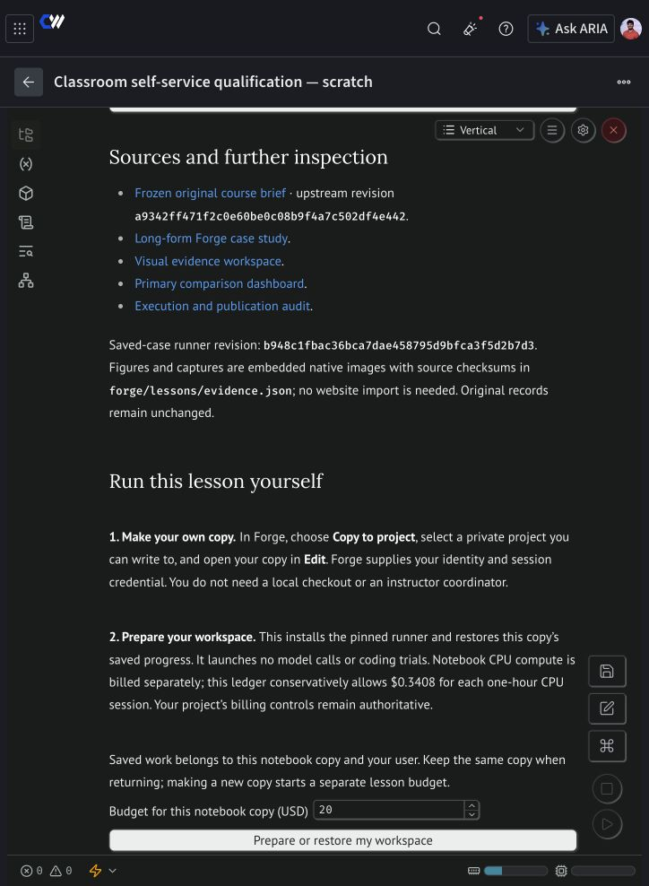

# Self-service lesson validation

The self-service revision is implemented in the canonical notebook sources. It
has **not replaced the nine published master notebooks** while live qualification
is incomplete.

## Verified on 2026-11-09

- All nine native Marimo notebooks pass saved-view execution without credentials.
  The validator recomputes historical aggregates and checks images and downloads.
- Historical embedded evidence and each notebook's exact runner revision are
  unchanged from the previous notebook PR head.
- Sixteen regression checks pass for initialization without side effects, owner
  isolation, checkpoint round trips, unsafe archive rejection, redaction, explicit
  graph decisions, bounded loops, and fail-closed launch/budget behavior.
- The documentation builds successfully with the existing large-bundle warning.
- A fresh private Forge notebook received its own session identity and credential.
  The credential could read the private project and the selected inference model.
- Automatic setup installed Git and checksum-verified Node 22.19.0, fetched the
  pinned course revision, installed lockfile dependencies, compiled the shared
  services, and saved a learner-specific W&B progress artifact.
- Project 01's native controls were loaded through the normal Marimo source
  editor and inspected in Forge preview. No HTML import was used.

## Live boundary found

The notebook-injected runtime credential is rejected by the Sandbox API. The
qualification stopped before calling Pi or an inference model. An inventory read
using the account's normal credential found no sandbox matching the qualification
ID. Its learner ledger retains the missing-usage halt until an operator records
that reconciliation. No successful coding trial is claimed for this revision.

The implementation now offers **Connect my sandbox access**, using Marimo's masked
`getpass` prompt. It verifies that the supplied key belongs to the notebook session
owner and can access the Sandbox API. The key stays in process memory and is
redacted from logs and exports. This path still needs a full live qualification.

The test also exposed a W&B background-service connection loss on the completion
save. Progress writes now use isolated Python processes, and child coding
processes do not inherit a W&B service handle. The updated completion-save path
still needs live verification.

Automatic approval review rejected transferring the existing account key into
the private scratch runtime because that specific credential transfer was not
authorized. The user has been asked to approve the transfer or enter the key.
Publication remains pending that test, including a complete graded trial and a
fresh-runtime restore of the saved progress. Local checks do not substitute for
those live checks.

The scratch notebook runtime was terminated and its terminal state verified.
Its CPU estimate is **$0.122258308**. There were **zero** model calls and no
worker sandbox found for the rejected qualification. The global test reservation
was settled at zero worker/inference cost; the retained student checkpoint still
records the failed authentication and requires operator reconciliation. The local
accounting ledger has no outstanding reservation for this test.

## Scope that remains explicit

These controls run the existing adapted Forge tasks. They do not certify the
additional original-course deliverables. Project 07 uses the bounded ten-minute,
one-round exercise; a one-hour notebook runtime cannot host the original two-hour
monitor. Project 08 preserves explicit candidate-bound approval. An actual student
account rehearsal and team billing/access setup remain instructor responsibilities.
