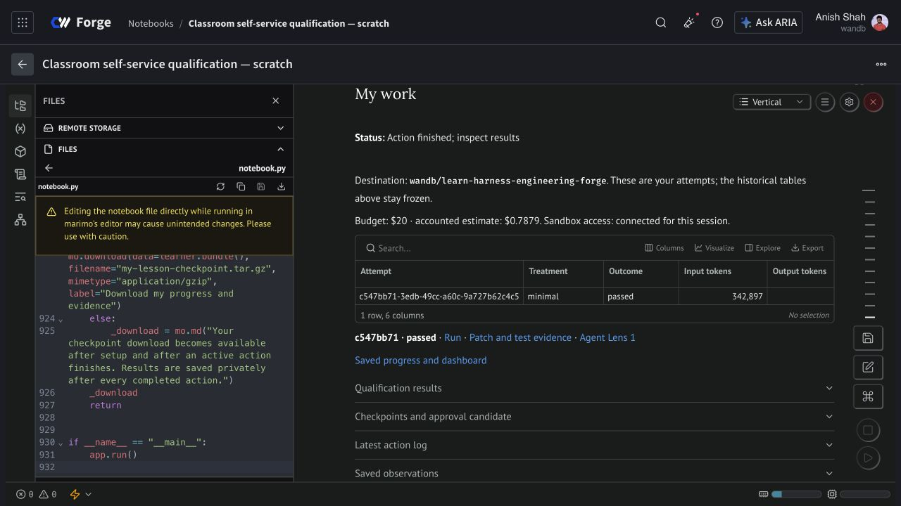

# Self-service lesson validation

The shared learner workflow passed live validation in a private Forge notebook on
2026-11-09. The nine master notebooks are being updated through the normal Marimo
editor; the publication manifest is authoritative for each committed version.

## What ran

- Two successful live qualifications: one from the coordinator and one from the
  actual notebook button after masked key entry. Each exercised Pi tools, hosted
  inference, app tracing, cancellation, and sandbox cleanup.
- One Project 01 minimal-treatment trial,
  `c547bb71-3edb-49cc-a60c-9a727b62c4c5`, passed all five independent checks:
  compilation, persisted import, indexing, retrieval/Q&A, and Electron under Xvfb.
  Pi reached its bound (`actorCompleted=false`); the exported patch passed.
- All five Agent Lens conversations were read back. Model-level token totals,
  parent links, source metadata, and conversation boundaries matched the records.
- W&B run configuration and metrics matched the committed evidence artifact,
  including the patch, grade, and Electron screenshot.
- Native setup, masked connection, qualification, and observation saving were
  exercised in Forge. The completed coding trial used the same coordinator.
- After terminating that runtime, a fresh runtime opened idle with no workspace.
  Clicking Prepare restored the trial, observations, and budget history. Account
  key access remained disconnected. The restore-only runtime was then terminated.

[Trial and metrics](https://forge.coreweave.com/wandb/wandb/learn-harness-engineering-forge/runs/c547bb713edb49cc)
· [Private progress run](https://forge.coreweave.com/wandb/wandb/learn-harness-engineering-forge/runs/lesson-88850bc3b9d59dbe46d7)

## Failures found and retained

Forge's injected notebook credential can save progress and use inference, but the
Sandbox API rejected it before a model or worker launched. An authenticated
inventory found no worker for that attempt. Its zero-cost reconciliation is
recorded; the failed qualification remains in the learner's evidence.

The user then explicitly approved testing their existing account key in the
private runtime. The key was held in memory, owner-checked, and entered through
Marimo's masked prompt. That prompt is visible in **Edit**, not Preview. A scan of
3,190 workspace files and checkpoint contents found neither the account key nor
the injected credential. The key-bearing runtime and all four workers were
confirmed terminal.

The live test exposed a background W&B service failure and an indentation bug in
the helper's embedded save script. Saves now run in isolated Python processes,
and the nested Marimo representation has a regression check. Native saving and
fresh-runtime restoration passed after the fixes.

## Local checks and cost

All nine saved views execute without credentials and reproduce the historical
aggregates, images, and downloads. Seventeen regression checks pass. The docs
build passes with its existing large-bundle warning. Historical evidence and the
pinned runner revisions remain unchanged.

Worker compute and inference for the two successful qualifications and one trial
are estimated at **$0.106255**. The key-bearing and restore-only notebook sessions
add **$0.141952**. The earlier rejected-credential session adds **$0.122258**.
These are application estimates, not provider billing totals; publication sessions
are accounted separately. The restored learner ledger conservatively charges a
full $0.3408 allowance per notebook session, so it is intentionally higher.

## Limits

This is one owner-account rehearsal of the shared workflow, not nine new live
campaigns or a test of student entitlements. Before class, repeat setup with an
actual student account and its private destination. A passed preset run does not
complete every original assignment. Project 07 uses the bounded ten-minute,
one-round adaptation; Project 08 still requires candidate-bound approval.
CPU sandboxes and hosted inference were used. No GPU training was run.
