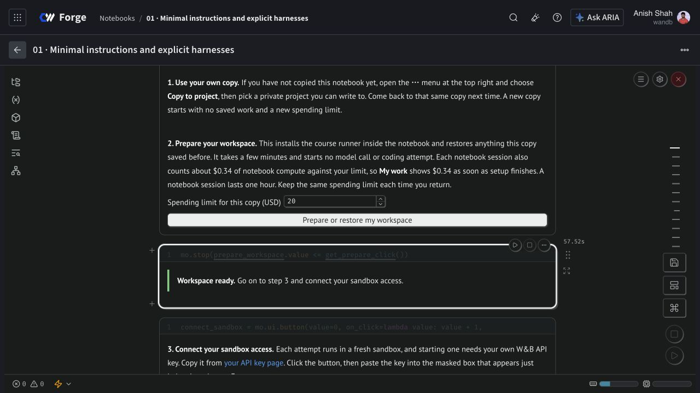

# Command cancellation repair — 10 November 2026

Project 01's small paid check failed before making any model request. Its 500 ms timeout expired while the gateway was still starting the command. Cleanup read the process marker `pending` and tried to parse it as an integer. The fallback terminated the sandbox, and the known $0.001840699 estimate was settled. The failed attempt remains in the learner's history.

The runner now gives startup its own 30-second deadline and begins the unchanged execution allowance after the remote process ID is durable. Launch and cancellation share a lock. Cancelling before launch leaves a marker that prevents a delayed command from starting; cancelling after launch terminates and checks the process group. Qualification requires evidence that the command actually started, timed out, and was stopped. A startup error cannot pass that test.

The repaired runner is `4f5e5bedd473f04ebb7e362193af70119279b862`, retained by tag `forge-course-runner-v5-cancellation-4f5e5bed`. All nine lessons use it. Their cell order, text, labels, images, and historical results are unchanged. Code and notebook sources are pushed through the existing draft PR stack; no PR was merged.

## What passed

- All 71 TypeScript tests, including real process-group cleanup, and 39 learner coordinator tests.
- All nine local saved-view validations.
- A fresh live qualification: verified timeout cancellation, two Pi model calls with a real sandbox tool call, and two app inference calls. Agent Lens readback matched all 1,379 input and 1,827 output tokens, with no duplicate or missing parent spans.
- Three fresh Project 01 acceptance controls: the unfinished baseline failed the UI check, the protected repair passed all five checks, and the regression failed the UI check. Electron ran under Xvfb.
- The actual Project 01 Prepare button restored the previous failed attempt and spending, installed the new runner, and reached **Workspace ready**. The verification session added its normal $0.3408 notebook allowance; that is a conservative view of the same compute, not another invoice charge.

The qualification and three controls together cost an estimated $0.015182341. Editor costs, terminal receipts, committed notebook versions, source checksums, and rendered-output checksums are recorded in [verification.json](verification.json). The private [verification run](https://forge.coreweave.com/wandb/wandb/learn-harness-engineering-forge/runs/course-cancellation-repair-20261110) contains the results and versioned evidence artifact. These are qualification checks, not additional comparison attempts.

All nine committed sources and rendered outputs passed final readback. Eight publication editors are verified terminal. After publication, Forge began returning HTTP 500 with CoreWeave `PermissionDenied: access denied` for termination, and the sandbox SDK also rejected status/stop requests. Cleanup of the final Project 04 and Project 08 editors remains unverified. Their two $2 reservations remain held, and the rollout ledger blocks further paid launches. The native Project 04 kernel shutdown was requested; that is not treated as proof that its cloud sandbox stopped. No platform source or access settings were changed.

## Continue the lesson

After sandbox-management access is restored and the remaining cleanup is reconciled, close the old notebook tab and reopen [Project 01](https://forge.coreweave.com/notebooks/Tm90ZWJvb2s6MTUzMTQ%3D). In Edit view, keep the existing $20 limit, press **Prepare or restore my workspace**, and wait for **Workspace ready**. Use **Connect my sandbox access**, enter your own key in the masked input, and press Enter. Select **Check that everything works (small paid test)** and press **Start** once after confirming the paid action.

The previous failed check remains visible until the new check finishes. Do not create another copy to erase it. Existing separately copied notebooks remain pinned until explicitly updated. Reopening the original above loads the published repair.

This verification used the owner account. Independent student-account rehearsal and the native download remain unverified; the latter was left unverified at the user's request. The full corrected research campaign remains incomplete. The original unknown-usage reservation and the historical 129-attempt archive and 39-attempt comparison were not changed.
