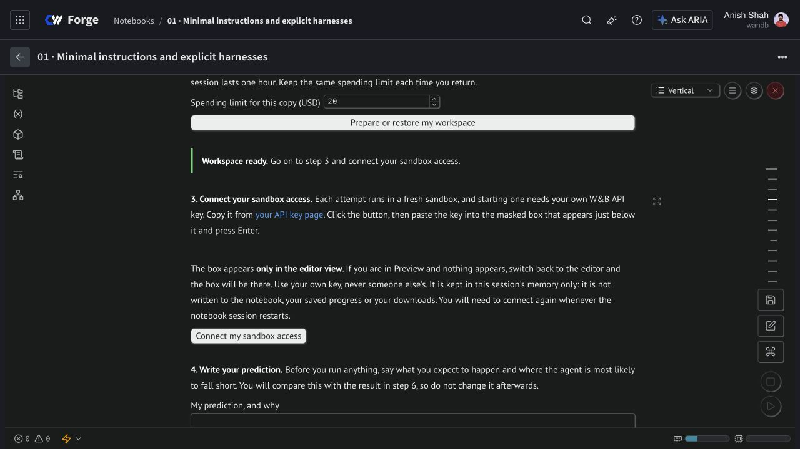

# First-use setup repair — 10 November 2026

The reported Project 01 error, **Setup stopped. HTTP Error 404: Not Found**, was reproduced using the notebook's own injected credential. Project access succeeded. The next request failed because it looked up a named learner-progress artifact collection before that collection existed. The prior scratch rehearsal had existing progress and did not exercise this case.

The shared coordinator now requests an exact filtered collection list for both restoration and the first progress save. A complete empty response permits first-time setup. Network errors, authorization failures, incomplete responses, unexpected names and pagination still block setup; they are never treated as zero spending or missing history.

The actual Project 01 **Prepare or restore my workspace** button completed installation and a verified first save. Pressing it again retained the same $0.3408 notebook allowance. A separate clean directory restored the remote checkpoint with matching spending and notes and disconnected sandbox credentials. This check started no inference request or coding trial.

The repair is embedded in all nine canonical notebooks. Cell order, lesson text, headings, labels, images and historical results remain unchanged; only the coordinator code and runner revision differ. The runner is retained by the immutable tag `forge-course-runner-v5-first-use-4022ecfd`. All 55 Python tests and nine local saved-view validations passed. See [verification.json](verification.json) and the [publication manifest](../../publication-manifest.json) for live publication and cleanup receipts.

All nine sources and rendered outputs were read back after their native-editor saves and again after termination. The nine editors used for this repair are verified terminal. Their additional conservative estimate is $0.304961188, bringing the separately authorized rollout ledger to $2.339438351 of $25, with no outstanding reservations. The learner's $0.3408 session allowance is a separate conservative view of that same notebook compute, not an additional invoice charge.

To use the repaired original, reopen [Project 01](https://forge.coreweave.com/notebooks/Tm90ZWJvb2s6MTUzMTQ%3D), run its cells, and press Prepare. Continue only when it says **Workspace ready**, then use **Connect my sandbox access** in Edit view. New copies inherit the repair. Existing copies remain pinned until explicitly updated; retain their progress and spending rather than copying again to bypass unresolved work.

The original unknown-usage reservation and the historical experiment grades are unchanged. Native downloads remain unverified at the user's request. This is a setup and recovery check with the owner account, not a new agent comparison or an independent student-account rehearsal.
