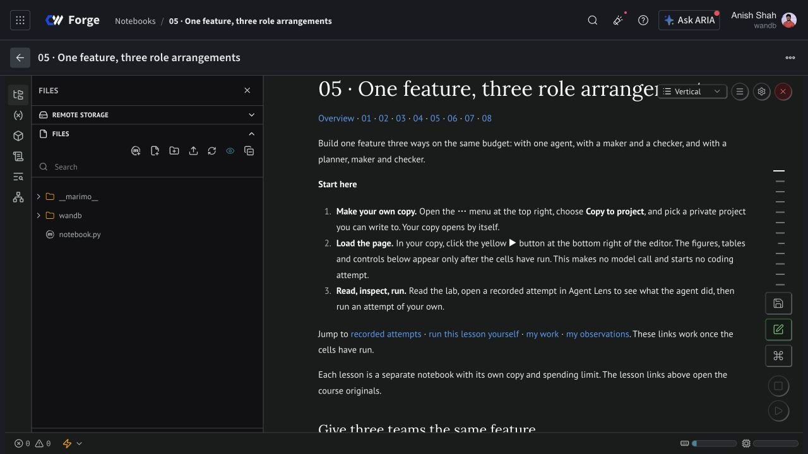
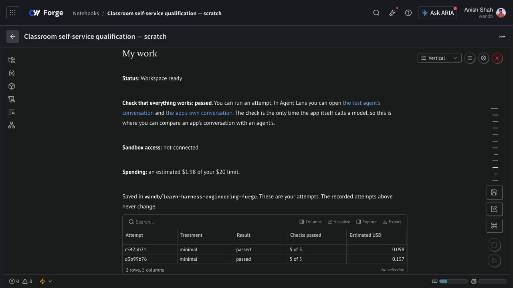

# Supplied iteration: publication and live verification

Verified on 10 November 2026. All 27 supplied files were committed unchanged in [`9448aa4326b933e5660126c2ba9c6f4cfbd26e35`](https://github.com/ash0ts/learn-harness-engineering/commit/9448aa4326b933e5660126c2ba9c6f4cfbd26e35). SHA-256 checks cover every input file. This publication layer adds receipts and screenshots; it does not alter the supplied lessons, controls, frozen results, or pinned runner.

All nine existing Forge notebooks now contain that source. Their committed source, rendered cell source, saved aggregates, figures, and static lab downloads were read back after publication runtimes stopped. The files were loaded in the native Marimo editor and saved with Forge's installed save worker. No HTML import was used.

The live student flow completed with instructor interventions. **It is not yet verified as fully hands-off.** One bounded Project 01 patch passed all five protected checks, including Electron/Xvfb; its run, evidence artifact, and five conversations were independently read back. Saving notes and restoring them in a fresh runtime passed. The browser progress-download control remains unverified.

| Lesson | Forge | Committed version |
|---|---|---|
| Overview | [Open notebook](https://forge.coreweave.com/notebooks/Tm90ZWJvb2s6MTUzMTM%3D) | v32 |
| project-01 | [Open notebook](https://forge.coreweave.com/notebooks/Tm90ZWJvb2s6MTUzMTQ%3D) | v24 |
| project-02 | [Open notebook](https://forge.coreweave.com/notebooks/Tm90ZWJvb2s6MTUzMTU%3D) | v20 |
| project-03 | [Open notebook](https://forge.coreweave.com/notebooks/Tm90ZWJvb2s6MTUzMTY%3D) | v19 |
| project-04 | [Open notebook](https://forge.coreweave.com/notebooks/Tm90ZWJvb2s6MTUzMTc%3D) | v16 |
| project-05 | [Open notebook](https://forge.coreweave.com/notebooks/Tm90ZWJvb2s6MTUzMTg%3D) | v16 |
| project-06 | [Open notebook](https://forge.coreweave.com/notebooks/Tm90ZWJvb2s6MTUzMTk%3D) | v15 |
| project-07 | [Open notebook](https://forge.coreweave.com/notebooks/Tm90ZWJvb2s6MTUzMjA%3D) | v15 |
| project-08 | [Open notebook](https://forge.coreweave.com/notebooks/Tm90ZWJvb2s6MTUzMjE%3D) | v18 |

## Validation

- 23 learner-workspace regression tests and 39 TypeScript tests passed.
- Type checking, the documentation build, and all nine local Marimo saved-view executions passed.
- Every supplied file remains byte-identical to its input fingerprint.
- All nine notebook sources match the committed canonical files; historical results and pinned runner revisions remain unchanged.

## Live result and interventions

The private owner-account rehearsal used the new Project 01 notebook with its existing pinned runner `b948c1fbac36bca7dae458795d9bfca3f5d2b7d3`.

The first qualification rejected malformed live app output. Both agent and app calls reported token usage, and the sandbox was confirmed complete. An instructor reconciled its conservative $0.007749 estimate using the existing budget API. The failed qualification remains recorded. One retry with unchanged settings passed, costing an estimated $0.008785.

Trial [`d3b99b76-12ca-4b30-8d07-0f3b1a018206`](https://forge.coreweave.com/wandb/wandb/learn-harness-engineering-forge/runs/d3b99b7612ca4b30) passed all five checks: compilation/build, import/persistence, indexing, retrieval and two-turn Q&A, and Electron under Xvfb. It recorded 383,880 input and 7,800 output tokens, with estimated worker/inference cost $0.156788. Pi reached its model-call bound; `actorCompleted=false` remains explicit. The [coding conversation](https://forge.coreweave.com/agent-lens/wandb/learn-harness-engineering-forge/conversations/01a1c5a8-6555-7344-8d5f-9d329e1c26a3) and committed trial artifact match the recorded usage and outcome.

Grading finished at 13:40:43 UTC. Both remote workers were complete, but the local worker process remained open. At 13:46:22 UTC an instructor sent SIGTERM to that completed child. The existing parent then settled the trial, published the W&B run/artifact, and saved progress normally. This was an operational intervention, not a code fix; its underlying cause remains unresolved.

Native worksheet saving preserved an earlier prediction when its field was blank. A fresh runtime restored the new trial, notes, and prior cost settlements with no pending reservation; sandbox access remained disconnected. A scan of 3,273 runtime files and archive members found no matches for the tested account-key/JWT forms.

The new lazy progress-download control appeared and was clicked, but a completed browser download was not observed. The saved progress artifact was separately collected and successfully restored. Those are separate checks; artifact recovery does not prove that browser downloading works.

## Scope, cleanup, and cost

All eleven notebook sessions and four remote qualification/actor/grader workers are terminal. The application ledger has no outstanding reservations or usage halt. This iteration's estimates total **$0.492766**: $0.127854 for publication notebooks, $0.191590 for rehearsal/restore notebooks, and $0.173322 for inference and trial workers. These are estimates, not provider billing totals; the already-running Project 01 publication session is counted only from this verification window.

This verifies nine published saved views and one live Project 01 attempt. It does not rerun the full eight-project campaign, test actual student entitlements, repeat the two-hour loop, exercise a new graph approval, or use a GPU sandbox. Original-course coverage gaps and frozen comparison limitations remain in the supplied lessons.

The [machine-readable receipt](iteration-2026-11-10.json) includes checksums, notebook versions, run and trace identifiers, cleanup receipts, reconciliation, and restore checks. Raw transcripts, patches, and learner bundles stay in the private project or ignored local evidence.
