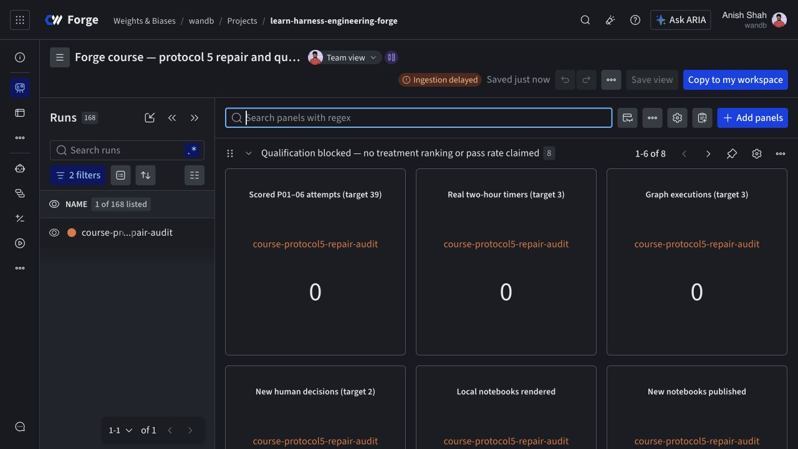

# Protocol 5 repair status

**Rollout is blocked on missing provider usage.** Runtime repairs and candidate notebooks are locally validated. No corrected scored campaign or repaired notebook publication is claimed.

Candidate notebook runner: `dcf7e447f565961e790ed1f4a25815b278db124e`. Historical evidence remains byte-for-byte unchanged: 129 archived attempts and 39 primary comparisons.

| Check | Actual result |
| --- | --- |
| TypeScript tests | 61 pass; 0 fail |
| Learner and publication tests | 47 pass, plus 6 publication guards |
| Offline apps | 15/15 pass |
| Local saved notebook views | 9/9 render without credentials |
| Docs and anchors | Pass |
| Candidate notebooks published | 0/9; all previous remote sources unchanged |

| Corrected experiment | Completed | Target |
| --- | --- | --- |
| comparisonAttempts | 0 | 39 |
| loopControllers | 0 | 9 |
| realTwoHourTimers | 0 | 3 |
| graphs | 0 | 3 |
| verificationPairs | 0 | 3 |
| newHumanDecisions | 0 | 2 |

## Qualification and accounting

The qualification recorded 396 input and 61 output tokens on its first model request. The second request timed out without usage. Its sandbox was verified terminated; the conservative lifetime was 209.785 seconds. Agent Lens read-back did not provide the missing usage, and the billing query returned HTTP 403. The full $2 reservation remains unresolved. It is a reservation, not a measured charge. The uncapped research authorization does not override fail-closed accounting.

- Operation `qualification-b9c2070d-c685-41e6-8734-baac3fee02bb`, source `bed84c0dd83e64e9c2be0ee982572174ba30eda2`: failed; cleanup verified; usage incomplete. [Agent Lens conversation](https://forge.coreweave.com/agent-lens/wandb/learn-harness-engineering-forge/conversations/01a1c61e-b070-71d3-9b75-61e94eed0389).

## Resume safely

1. Obtain the missing provider usage receipt for the qualification. Use `recovery-report` and the evidence-bound `reconcile` command in [RECOVERY.md](../../RECOVERY.md). Do not delete the ledger or overwrite this failed outcome.
2. Run the frozen protocol-five qualification and all baseline/reference/regression controls before scored attempts. `python forge/scripts/protocol5.py freeze --schedule /path/to/evidence/schedule.json` records the exact inputs; `commands` displays the planned CLI invocations. `run --execute` refuses unresolved accounting and interrupted steps.
3. Run the 39-attempt comparison, nine loop controllers, three graphs and three balanced verification pairs. The scheduler never approves graphs. Two new checksum-bound decisions remain human work. An interrupted two-hour timer resumes through `loop --resume` with the original checkpoint and deadline.
4. Perform the owner rehearsal and native Forge Edit/Preview download test; inspect and restore the actual archive. The independent student-account gate remains unverified because no other tester is available.
5. Recheck remote edits, reserve notebook compute, and publish the same nine IDs through the native editor. Verify currentVersion, exact source bytes and rendered output before updating the original publication manifest.

## What remains unverified

- Corrected controls in the pinned CPU image under Xvfb.
- Complete protocol-5 scored campaign.
- Three real two-hour timers.
- Three graph executions and three serial/parallel pairs.
- Two new human graph decisions.
- Reproduction of the original full Pi lingering-worker failure.
- Authenticated Forge Edit and Preview downloads plus fresh runtime restore.
- Publication of these nine candidate sources through the native editor.
- Independent student-account rehearsal; user said only the owner can test.

## Notebook sources

These links still show the preceding hosted iteration. Candidate source checksums and current remote versions are recorded separately in `status.json`.

- [00-overview](https://forge.coreweave.com/notebooks/Tm90ZWJvb2s6MTUzMTM%3D) — prior version 32; candidate not published.
- [01-minimal-harness](https://forge.coreweave.com/notebooks/Tm90ZWJvb2s6MTUzMTQ%3D) — prior version 24; candidate not published.
- [02-workspace-docs](https://forge.coreweave.com/notebooks/Tm90ZWJvb2s6MTUzMTU%3D) — prior version 20; candidate not published.
- [03-session-recovery](https://forge.coreweave.com/notebooks/Tm90ZWJvb2s6MTUzMTY%3D) — prior version 19; candidate not published.
- [04-runtime-feedback](https://forge.coreweave.com/notebooks/Tm90ZWJvb2s6MTUzMTc%3D) — prior version 16; candidate not published.
- [05-role-separation](https://forge.coreweave.com/notebooks/Tm90ZWJvb2s6MTUzMTg%3D) — prior version 16; candidate not published.
- [06-capstone](https://forge.coreweave.com/notebooks/Tm90ZWJvb2s6MTUzMTk%3D) — prior version 15; candidate not published.
- [07-bounded-loops](https://forge.coreweave.com/notebooks/Tm90ZWJvb2s6MTUzMjA%3D) — prior version 15; candidate not published.
- [08-state-machine](https://forge.coreweave.com/notebooks/Tm90ZWJvb2s6MTUzMjE%3D) — prior version 18; candidate not published.

## Limits on the claims

- No GPU sandbox or training experiment is part of this CPU-only track. Forge serverless inference is separately qualified.
- Two SDK-only lifecycle probes exited cleanly; they did not reproduce the original Pi worker hang.
- Local controller tests and locally compiled reference repairs are not live course-trial evidence.
- The one new qualification failed before app qualification; the unknown second request is not charged as zero.
- Remote notebook sources were read back unchanged. They still contain the preceding iteration, not these candidate repairs.

## Private dashboard and evidence

[Open the protocol 5 dashboard](https://forge.coreweave.com/wandb/wandb/learn-harness-engineering-forge?nw=43tvw98k2nm) · [Audit run](https://forge.coreweave.com/wandb/wandb/learn-harness-engineering-forge/runs/course-protocol5-repair-audit). The run and versioned artifact are separate from historical comparison runs.

